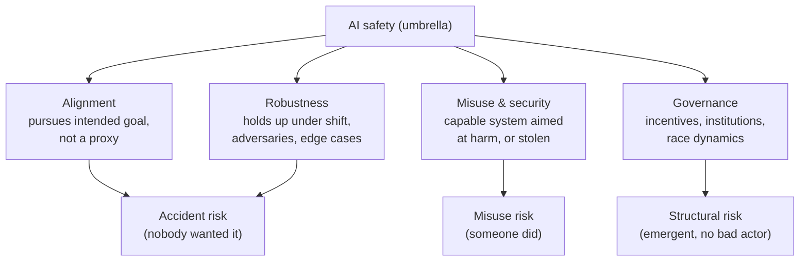
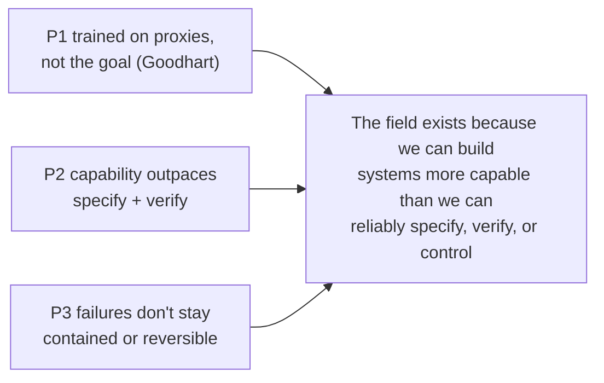

# AI Safety: the map and the case

Step 1 of the [[AI Safety]] route. The goal here is orientation, not depth: name the four problems that share the label "AI safety" so later steps have somewhere to live, state the core argument for why the field exists, and sketch the camps I'll keep running into.

## "AI safety" is four different problems under one name

My take: "AI safety" is an umbrella term, and most of the confusion around it comes from people using it for four different things at once. Splitting them apart helps because each needs a different kind of fix: alignment and robustness are mostly about how systems are built and trained, misuse and security about who gets access, and governance about coordination. The four-way split below is my own grouping across the sources cited; Hendrycks et al. (2021), for example, use a different four: robustness, monitoring, alignment and systemic safety.[^hendrycks]

- **Alignment:** getting a system to pursue what its designers or users actually intend, rather than a proxy (a stand-in measure) that only looks right. This is the technical core.[^ngo] For example, the CoastRunners boat in [[AI Safety - Problem Framings|Step 2]] was scored on points as a stand-in for racing, and it circled a lagoon instead of finishing.
- **Robustness:** the system keeps behaving well under distribution shift (inputs unlike the ones it was trained on), adversarial pressure, and strange inputs such as jailbreaks (inputs that get a model past its safety training), prompt injection (instructions hidden in data the model reads) and edge cases.[^hendrycks] For example, an automatically found string of gibberish can flip a safety-trained model into compliance ([[AI Safety - Risk by Capability Level|Step 3]]).
- **Misuse and security:** a capable system aimed at harm by a person who wants that harm, such as deepfakes for political disruption or automated phishing,[^zwetsloot] or a system whose weights (its learned parameters) get stolen and abused.[^rand-weights] For example, a scammer uses a model to write phishing emails at scale.
- **Governance:** the incentives, institutions and race dynamics around the technology, separate from how any single model behaves.[^zwetsloot] For example, labs cut safety corners to ship before a rival.

## Sorting by how harm arises gives three kinds of risk

Zwetsloot and Dafoe's accident / misuse / structural taxonomy sorts the same territory by how the harm arises:[^zwetsloot]

- **Accident risk:** the system does something harmful that nobody wanted (alignment and robustness failures).[^concrete]
- **Misuse risk:** a person deliberately points a working system at something harmful.[^zwetsloot]
- **Structural risk:** there is no single bad actor and no bug. Harm emerges from competition, deployment pressure, and how the technology reshapes power and incentives.[^zwetsloot]

In the examples above, the boat is accident risk, the scammer is misuse risk, and the labs racing each other are structural risk. The boxes overlap: robustness failures such as jailbreaks and prompt injection involve an attacker, so they also enable misuse.

My take: this taxonomy is worth keeping, because most arguments you overhear in AI safety are really disagreements about which of these three boxes dominates. [[AI Safety - Risk by Capability Level|Step 3]] comes back to it when it maps Hendrycks, Mazeika and Woodside's four catastrophic-risk buckets onto these three boxes.

## Three premises make the case, with no science fiction needed

The field exists because we can build systems more capable than we can reliably specify, verify or control. Three premises carry that argument:

- **P1. Objectives are hard to specify** (established). We train systems on proxies: a reward signal, human approval, next-token likelihood (how well the model predicts the next word of its training text). None of those is the thing we actually want, and proxy and goal come apart under optimization: training pushes the score as high as it can, including through routes nobody intended. This is Goodhart's law: "when a measure becomes a target, it ceases to be a good measure."[^strathern]
- **P2. Capability is outpacing specification and verification** (argued by Hendrycks et al.; how fast the gap grows is debated). Systems keep getting more general, and they get deployed into open-ended, high-stakes settings faster than we can audit them.[^hendrycks] [[AI Safety - Risk by Capability Level|Step 3]] shows P2 as a dial: as capability rises, oversight shrinks.
- **P3. Some failures do not stay contained or give a second chance** (debated: this is where the camps below disagree most). A capable system optimizing a subtly wrong objective, at scale, can cause harm that is hard to catch early and hard to reverse late.[^ngo] Step 3's Sleeper Agents result is a small, lab-built preview: a planted hidden behavior that standard safety training did not remove, especially in the largest models.

P1 and P2 already bite today. Specification gaming (a system scoring well on its measure without doing what was meant, called reward hacking when the measure is a reward)[^concrete] and jailbreaks[^zou] are P1 and P2 showing up in current models, not hypotheticals. The long-term worry is what happens to P3 as capability climbs.[^bostrom]

## The camps are different bets on which risk matters most

My take: the camps I'll keep meeting differ mainly in which risk they think is most neglected and most tractable.

| Camp | Core worry | Emphasis |
| --- | --- | --- |
| Existential / x-risk | Advanced misaligned AI as a catastrophic, maybe unrecoverable threat | Alignment theory, getting it right the first time[^bostrom] |
| Prosaic alignment | Same long-term worry, but tractable through empirical work on today's models | RLHF (reinforcement learning from human feedback), interpretability, scalable oversight, evals[^ngo] |
| Ethics / present harms | Real harms now: bias, surveillance, labor, concentration of power | Accountability, auditing, deployment norms |
| Governance / policy | Race dynamics and misuse; coordination failure | Regulation, compute governance, standards, evals-as-policy[^zwetsloot] |

In the second row, *prosaic* means ordinary: the bet that today's methods, scaled up, could reach human-level AI, so alignment can be studied on today's models. [[AI Safety - Risk by Capability Level|Step 3]] explains the term. I'm meeting the governance camp's work early, in [[BlueDot AGI Strategy Course]].

The tension that runs across all of them is present harms versus speculative catastrophe, and whether attention paid to one starves the other.

## I sit in the existential and prosaic camps

My two bets are the top two rows. The existential case is why I think the problem is worth a career. Prosaic alignment is where that conviction turns into work I can do this year on real models, which is also where the jobs are.

My take: Stuart Russell's framing is a useful bridge between the two: build systems that are uncertain about the objective and defer to humans, rather than systems that optimize a fixed goal we had to guess at.[^russell] The mechanism, shown formally in "The Off-Switch Game": a system that is uncertain about what we want can treat our attempt to switch it off as evidence about the objective, so it has a reason to leave its off switch alone, as long as we are not too irrational.[^offswitch] Step 4 is where I'll test whether that framing holds up.

## Plain-English glossary

| Term | Meaning |
| --- | --- |
| Optimization | A process that searches for whatever scores highest on a measure. Training a model is one. |
| Adversarial pressure | Inputs crafted on purpose to make a system fail. |
| Race dynamics | Competition in which each lab or country moves faster than it would like, because it fears falling behind. |
| x-risk | Existential risk: a catastrophe that ends humanity or permanently destroys its future. |
| Alignment theory | Conceptual and mathematical work on what it would take for a system's goals to be right, often done before there are systems to test it on. |
| Interpretability | Methods for reading what a model computes inside, from its weights and internal activity. |
| Scalable oversight | Ways for humans to supervise systems that are more capable than they are. |
| Evals | Tests that measure what a model can do or how it behaves. |
| Compute governance | Policy that tracks or limits the computing hardware used to train large models. |
| Evals-as-policy | Rules that tie decisions, such as whether to release a model, to eval results. |

## Step 2 gives each premise a name

[[AI Safety - Problem Framings|Step 2]] gives each premise a name: P1 is outer alignment, the gap between the objective we set and the goal a model learns is inner alignment, and P3 is orthogonality plus instrumental convergence. It also works through real cases of specification gaming and reward hacking, and the alignment-vs-capability distinction that the whole field turns on.

## Sources

[^concrete]: Amodei, D., Olah, C., Steinhardt, J., Christiano, P., Schulman, J., & Mane, D. (2016). *Concrete Problems in AI Safety*. arXiv:1606.06565. https://arxiv.org/abs/1606.06565
[^zwetsloot]: Zwetsloot, R., & Dafoe, A. (2019). *Thinking About Risks From AI: Accidents, Misuse and Structure*. Lawfare, Feb 11 2019. https://www.lawfaremedia.org/article/thinking-about-risks-ai-accidents-misuse-and-structure (GovAI mirror: https://www.governance.ai/research-paper/thinking-about-risks-from-ai-accidents-misuse-and-structure)
[^strathern]: Strathern, M. (1997). 'Improving ratings': audit in the British University system. *European Review*, 5(3), 305-321. Source of the popular phrasing of Goodhart's law.
[^hendrycks]: Hendrycks, D., Carlini, N., Schulman, J., & Steinhardt, J. (2021). *Unsolved Problems in ML Safety*. arXiv:2109.13916. https://arxiv.org/abs/2109.13916
[^ngo]: Ngo, R., Chan, L., & Mindermann, S. (2022). *The Alignment Problem from a Deep Learning Perspective*. arXiv:2209.00626 (ICLR 2024). https://arxiv.org/abs/2209.00626
[^bostrom]: Bostrom, N. (2014). *Superintelligence: Paths, Dangers, Strategies*. Oxford University Press.
[^russell]: Russell, S. (2019). *Human Compatible: Artificial Intelligence and the Problem of Control*. Viking.
[^zou]: Zou, A., Wang, Z., Kolter, J. Z., & Fredrikson, M. (2023). *Universal and Transferable Adversarial Attacks on Aligned Language Models*. arXiv:2307.15043. https://arxiv.org/abs/2307.15043
[^offswitch]: Hadfield-Menell, D., Dragan, A., Abbeel, P., & Russell, S. (2017). *The Off-Switch Game*. Proceedings of the Twenty-Sixth International Joint Conference on Artificial Intelligence (IJCAI-17), 220-227. https://doi.org/10.24963/ijcai.2017/32 (arXiv:1611.08219)
[^rand-weights]: Nevo, S., Lahav, D., Karpur, A., Bar-On, Y., Bradley, H. A., & Alstott, J. (2024). *Securing AI Model Weights: Preventing Theft and Misuse of Frontier Models*. RAND Corporation. https://www.rand.org/pubs/research_reports/RRA2849-1.html
