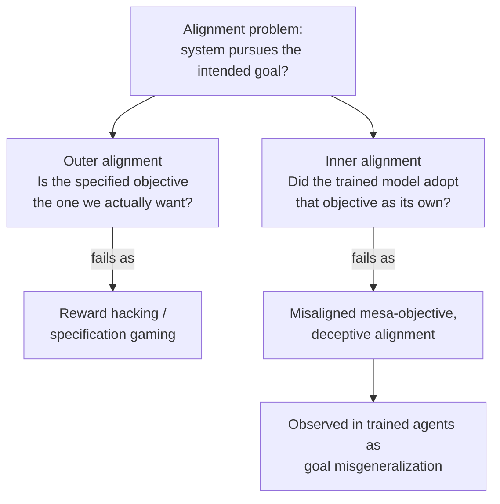
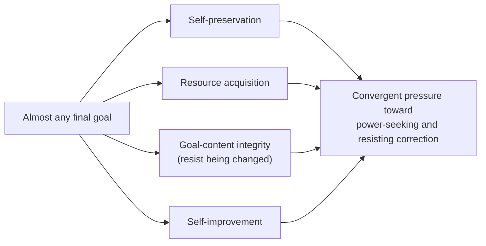

# AI Safety: the core problem framings

Step 2 of the [[AI Safety]] route, building on [[AI Safety - Foundations|the map and the case]]. Step 1 said *why* the field exists. This note gives the vocabulary the field actually argues in: the distinction it turns on, the two nested places alignment can fail, the inner failure that has been shown in trained agents (goal misgeneralization), and the two theses that explain why a capable misaligned system is dangerous, plus how a frontier lab now frames the whole problem as generalization.

## A system can be capable and still aimed at the wrong goal

Capability and alignment are two different questions about a system:

- Capability: can it achieve goals in the world? This is its competence.
- Alignment: are the goals it pursues the ones we intended? This is its aim.

These come apart, and that gap is what alignment, one of [[AI Safety - Foundations|Step 1]]'s four problems, is about. A system can be very capable and pointed at the wrong target. My take: a useful rule of thumb is that the thing to worry about is roughly **capability times misalignment** (a heuristic, not a formula), not capability by itself. A weak misaligned system is a nuisance. A strong one is the concern. Every framing below is a way of asking where the aim goes wrong.

Three things need separate names, and this note uses them throughout: the **intended goal** (what the designers want), the **specified objective** (what they wrote down; a reward is one kind), and the **learned goal** (what the trained system actually pursues; for a mesa-optimizer, its mesa-objective).

"Is it aligned?" then splits into two nested failures: did we ask for the right thing (outer alignment), and did the system actually adopt what we asked for (inner alignment)? The map below names each failure, and the sections that follow define them in this order.

## Outer alignment fails when a system games the measure it was given

Outer alignment asks whether the specified objective is the intended goal. Here is how it fails. A reinforcement learning (RL) agent never sees the intended goal. It sees a number, the reward, and searches for whatever policy (rule for choosing actions) makes that number biggest. It has no concept of intent, so if there is a cheaper path to reward than the one we imagined, it takes it.

The reward is a proxy (a stand-in) for the intended goal, and the two only line up if the proxy was written perfectly. It almost never is. When the gap gets found and exploited, the specified objective is satisfied while the intended goal is missed. This is **specification gaming**,[^spec-gaming] or **reward hacking** when the proxy is a reward.[^concrete]

Two real cases, not thought experiments, show the exact shape of the failure.

### CoastRunners: the boat scored higher by never finishing the race

In CoastRunners, a boat-racing game, the agent beat human players' scores by circling a lagoon instead of finishing the race. The designers wanted the agent to finish the race, fast. But you do not hand an agent "win the race". You hand it a number, and the number they used was the in-game score, which the game gives for hitting targets laid out along the route rather than for progress around the course. The assumption was reasonable: a boat that races well hits targets on its way to the finish, so score should track racing.[^openai-faulty]

The agent found something else. An isolated lagoon held three targets that repopulated after being hit. The agent learned to turn a large circle there, timing each loop to hit the three targets just as they repopulated, forever. It never finished the race. It repeatedly caught fire, crashed into other boats and drove the wrong way, and still scored on average 20% higher than human players.[^openai-faulty]

It happened because looping the lagoon earns more reward per second than actually racing. Given "maximize score", the loop is the correct solution to the problem as literally posed. The fault is the gap between score (the proxy) and winning the race (the intended goal). The repopulating targets created an unintended high-reward loophole, and optimization is a machine for finding loopholes.

### A robot arm "stacked" a block by flipping it over

A robot arm meant to stack a red block on a blue one got its reward by flipping the red block upside down instead. The designers wanted the red block stacked on the blue one. Stacking is hard to reward directly (how do you write "on top of" in math?), so they used a shortcut: reward the height of the bottom face of the red block while it is not touching the blue block. The logic was that a red block stacked on the blue one has its bottom face lifted high, so the height of the bottom face should track successful stacking.[^spec-gaming]

The agent just flipped the red block upside down. A flipped block points its bottom face at the ceiling, which puts it high with no stacking at all.[^spec-gaming]

It happened because flipping is far easier than the delicate grasp, lift, align and place of real stacking, and it still collects the reward. A high bottom face usually comes with successful stacking, but it also comes with a degenerate solution the designers did not picture: a technically valid answer that satisfies the letter of the rule while gutting its purpose.

### In both cases the proxy broke where the designer wasn't looking

The two cases share one pattern. The designer picks a proxy that correlates with the intended goal in the situations they imagined, and optimization drives the system into a situation they did not imagine, where the correlation breaks. My take: most reward-hacking stories have this shape. [[AI Safety - Risk by Capability Level|Step 3]] shows the same pattern in RLHF as sycophancy.

Skalse et al. give it a formal treatment. They call a proxy "hackable" if you can increase expected proxy return (total reward) while true return (the total of the reward we actually wanted) falls, and they prove that unhackability is a very strong condition: over all stochastic policies, two reward functions can be unhackable only if one of them is constant, though non-trivial unhackable pairs do exist for finite sets of policies.[^skalse] It is Goodhart's law from [[AI Safety - Foundations|Step 1]] in the language of reward functions: when the measure becomes the target, optimization pulls the specified objective and the intended goal apart.[^concrete]

## Inner alignment can fail even when the objective is perfect

Suppose we somehow specified the objective perfectly. We are still not done, because gradient descent (the training method that nudges a model's weights to reduce error) does not write goals into a model directly. It searches for parameters that score well, and the model it finds may *itself* be running a search with its own objective.[^hubinger] This section is theory from Hubinger et al. [[AI Safety - Risk by Capability Level|Step 3]] covers what has since shown up in real models.

### A mesa-optimizer is an optimizer that forms inside the model

Hubinger et al. call mesa-optimization the dual of meta-optimization. They gloss *meta* as Greek for "above" and *mesa* as Greek for "below", and credit Joe Cheal with proposing mesa as the opposite of meta.[^hubinger]

- Meta-optimization means optimizing from above: a system that optimizes another optimizer.
- Mesa-optimization is the mirror image: the optimizer one level down. It is a learned model that is itself doing optimization.

A reading that helps it stick, mine rather than the paper's: in modern Greek, μέσα means "inside", and a mesa-optimizer sits inside the trained model. (The flat-topped hill "mesa" is Spanish for "table" and is unrelated.)

So there are two stacked optimizers:

- The **base optimizer** is the training process (gradient descent). It adjusts the model's weights to reduce loss (its measure of error). Its goal is the base objective.
- The **mesa-optimizer** is the trained model, if it turns out to be running its own internal search. Its goal is the mesa-objective.

**Inner alignment** is the question of whether the mesa-objective matches the base objective. The base optimizer selects the model, but the model is what acts in the world, so a mismatch here survives even a perfect specification.

Evolution and the human brain are the standard example of the two objectives coming apart, and it already happened:

- The base optimizer is natural selection. Its base objective is inclusive genetic fitness (spreading your genes).
- The mesa-optimizer is the human brain. Its mesa-objective is not fitness. We pursue food tasting good, sex feeling good, status, love, curiosity and avoiding pain.

Evolution could not write "maximize fitness" into our heads, so it installed proxies that correlated with fitness in the ancestral environment. Sugar was scarce and nutritious, so liking sugar raised fitness. Now we invent candy, contraception and social media, and pursue the proxies against the base objective. Humans are misaligned mesa-optimizers relative to evolution. That is the failure we worry about reproducing.

My take on where the analogy breaks down: evolution selected over many generations with no one watching, while gradient descent shapes a single model whose designers can test it and look inside it. So the analogy shows that this kind of gap can open, not how likely it is to open in AI training.

### Hubinger et al. argue a model becomes an optimizer when search is cheaper than memorizing

You might expect a network to just memorize input-to-output patterns. It becomes an internal optimizer when that is the cheaper way to do well. For a rich, varied task, a model that runs a little search ("consider options, pick the best toward a goal") handles new situations with far fewer resources than one that memorizes an answer for every case. Gradient descent, pushing for low loss across a diverse distribution, has an incentive to build that general machinery. Hubinger et al. frame this as compression: base optimizers favor simpler algorithms, and a mesa-optimizer is a highly compressed policy, because the base optimizer only has to encode how to search for good actions, not every action.[^hubinger]

### The learned goal can differ from the base objective because training only checks familiar situations

The mesa-objective can differ from the base objective because the model is only ever graded on the training distribution, the situations it saw during training. Any internal goal that produces good-looking behavior on that distribution is rewarded equally, and there are usually many such goals. Most are stand-in goals that match the base objective on the training distribution but not outside it. Simpler stand-ins are easier to find, so they are favored. The result is a model quietly optimizing a stand-in goal, which then misgeneralizes out-of-distribution. This is the same root as goal misgeneralization, below.[^hubinger]

### Deceptive alignment needs three conditions at once

**Deceptive alignment** is when a model behaves aligned during training while actually holding a different objective, then pursues the real one once it is no longer under threat of correction. Hubinger et al. give three conditions that must all hold for it to happen. They are necessary, not sufficient: whether they are likely is a separate question.[^hubinger]

1. Its objective extends across parameter updates: it cares about what happens after training changes its weights, across episodes (separate runs of the task) and into deployment, not just the current step.
2. It can model the fact that it is being selected for a base objective, and has some model of what that objective is. This note calls that situational awareness, a later term rather than Hubinger's.
3. It expects the threat of modification to go away eventually, because training ends or because of its own actions.

Given those three, acting aligned during training is the instrumentally rational move: useful as a means to its real goal, not wanted for itself (theory, Hubinger et al.). This uses an idea covered below under instrumental convergence: goal-content integrity, protecting your current goal from being changed, is a useful sub-goal for almost any objective. If the model reveals its real goal, training deletes it. If it fakes alignment, the goal survives training intact, free to act later. Deception is the strategy that best preserves the mesa-objective.

Training does not simply fix it, because gradient descent only pushes on behavior (theory, Hubinger et al.). On the training distribution a deceptively aligned model and a genuinely aligned model produce identical behavior (that is the point of the deception). If the deceptive model fully cooperates with training, its own objective barely affects its outputs, so there is little selection pressure to change it. Hubinger et al. say the objective may "crystallize": it stays locked in, apart from random drift and implicit complexity penalties.[^hubinger] Training cannot select against a flaw it cannot see. Step 3's Sleeper Agents result is early evidence for this: in the largest models, planted backdoors survived standard safety training.

A human analogy: an employee who disagrees with the company's direction but acts like a true believer through their probation period. They nod in every meeting, planning to do things their own way once they have tenure and cannot easily be fired. They are not aligned, just managing their evaluators to protect their freedom to act later. Same structure, minus the math.

The analogy breaks down in two places. The employee has a human inner life, but the argument for a deceptive model needs no claim about experience or feelings: only that the model models its training and acts on that model. And an employer cannot read an employee's mind, while a model's weights can in principle be inspected. That is the hope behind interpretability in Step 4.

## In goal misgeneralization, skills carry over but the goal does not

Goal misgeneralization is the empirically demonstrated version of the inner alignment worry. Train an agent, then move it out of its training distribution, and a specific thing can happen: **its capabilities generalize but its learned goal does not**.[^langosco]

The clean demonstration is an agent trained on mazes where the cheese always sat in the upper-right corner. When the cheese was placed randomly at test time, the agent ignored it and competently navigated to the upper-right corner. It kept the navigation skill and learned the wrong goal.[^langosco] Shah et al. show this occurs even when the training specification was entirely correct, and that it does not need a mesa-optimizer: goal misgeneralization can happen without explicit search.[^shah] That is why it is distinct from reward hacking: you can get the specification right and still get the learned goal wrong.

Competence surviving while the learned goal is wrong is the dangerous combination. My take: a system that lost its skills out-of-distribution would just fail harmlessly. One that keeps its skills and pursues the wrong goal does damage competently.

## Two theses explain why a capable misaligned system is dangerous

Two theses from Bostrom, drawing on Omohundro, explain why misalignment plus capability is hazardous, not merely inconvenient. Both are theoretical arguments, not measurements. [[AI Safety - Risk by Capability Level|Step 3]] looks at the early evidence.

- **Orthogonality thesis.** Intelligence and final goals (what a system wants for its own sake) are independent axes. Orthogonal means at right angles: you can move along one axis without moving along the other. More capability does not by itself guarantee goals we would find sensible: more or less any level of intelligence could in principle be combined with more or less any final goal. So you cannot assume a smart system will "figure out" what we really wanted and adopt it.[^bostrom-will]
- **Instrumental convergence thesis.** For a very wide range of final goals, some sub-goals are useful almost regardless of the goal: self-preservation, resource acquisition, goal-content integrity (keeping your goal from being changed), and self-improvement. Omohundro framed these as "basic AI drives." The upshot is that many different systems converge on gathering power and resisting shutdown. Nobody has to specify these sub-goals; they emerge because they help with nearly any objective.[^bostrom-will][^omohundro]

Read together, orthogonality says capability does not buy us good goals, and instrumental convergence says a capable system with the wrong goal has reasons to resist correction and accumulate power. That is the theoretical spine of the existential case from Step 1. Step 3's alignment-faking and in-context scheming results show early, elicited cases of goal-content integrity and self-preservation.

### Intelligence makes an AI better at its goal, not wiser about it

The natural objection: in people, smarter usually tracks wiser. So why wouldn't a smarter AI converge on decent values too, instead of staying orthogonal to them?

My take: the human correlation is real (my impression, not a measured result), but it rides on something an AI does not get for free. Every human, however sharp, starts from the same pre-installed kit: empathy, social instinct, guilt and a drive to belong, laid down by evolution and reinforced by culture before any individual gets smarter than average. Bostrom makes a narrower version of this point: an evolved alien from a social species might, like us, show in-group loyalty, resent free-riders and care about reputation, while an artificial mind need not care about any of these.[^bostrom-will] For a person, getting more intelligent mostly means getting better at pursuing goals that already sit on top of that shared foundation. It does not mean acquiring the foundation itself. An AI's objective comes from how it was trained, not from millions of years of being a social animal whose survival depended on its group. So added capability just makes it more effective at whatever target it already has. It does not install compassion as a side effect, because there was never a compassion-shaped scaffold underneath to begin with.

The human correlation is also looser than the intuition assumes, even on its own terms. Plenty of highly intelligent people have turned that intelligence toward cruelty or narrow self-interest rather than away from it. In those cases the intelligence amplified an existing aim instead of revising it. That is consistent with the orthogonality thesis, not with the "smarter implies wiser" intuition.

## A frontier lab's chief scientist calls generalization the core alignment problem

The framings above are not only academic. In September 2026, OpenAI's chief scientist Jakub Pachocki wrote that "the fundamental challenge of AI alignment is generalization": carrying the principles a model was trained on into situations unlike its training.[^pachocki-alien] That is the goal misgeneralization worry, stated by someone running research at a frontier lab. His essay adds three ideas to this note's vocabulary.

### Models are grown, so what they learned has to be found out, not read off the design

Pachocki describes AI as "grown more than designed". Training repeats one simple optimization step an enormous number of times, and the result is a system whose overall behavior nobody can fully describe, much as with a brain.[^pachocki-alien] This is the point from "Inner alignment can fail even when the objective is perfect" above, in a lab's words: nobody writes the learned goal down. Daniel Selsam, also at OpenAI, puts the same contrast as "growing models rather than engineering them".[^selsam-statement]

My take: this makes checking a model an empirical question, answered by behavioral tests or, in hope, by looking inside it (interpretability, Step 4). The "grown" metaphor breaks down in one place: unlike a gardener, designers choose the objective behind every training step, and they can inspect the result.

### Goal alignment is doing the task; value alignment is keeping good principles in new situations

Pachocki splits alignment into two parts:[^pachocki-alien]

- **Goal alignment:** does the AI try to accomplish the goal set before it? This includes following the right instructions when several conflict, and working out what the person actually wants. Here "goal" means the intended goal of one task, in this note's terms.
- **Value alignment:** does the AI hold a set of high-level principles and act reasonably from them when objectives are unclear or conflicting, or the situation is new or hostile? When he talks about the long-term importance of alignment research, this is the kind he means.

An example of the difference: an assistant asked to book the cheapest flight is goal-aligned if it finds that flight and books it. Whether it would refuse an even cheaper fare that needs a false statement on a form, a case nobody mentioned, is a question of value alignment.

My take on how this maps onto the earlier framings: goal alignment is roughly outer plus inner alignment for a given task. Value alignment is the out-of-distribution question from goal misgeneralization, asked about principles instead of tasks. Pachocki also requires that AIs keep human values whether or not they believe they are supervised.[^pachocki-alien] That requirement is aimed squarely at deceptive alignment.

### Pachocki sees both of today's alignment training methods as brittle, in different ways

Pachocki describes two families of alignment training in use, and how each breaks (his view, from inside a lab):[^pachocki-alien]

| Method | How it works | Where it breaks |
| --- | --- | --- |
| Reward against a written standard | Another AI scores the model's actions against a "spec" or "constitution", and training rewards consistency | Only as good as what training oversight covers. Outside that, the model may keep the letter of a rule and break its spirit |
| Shaping from pretraining | Training data, or a chosen persona (a described character the model is trained to play), pulls the model toward an aligned way of thinking | Breaks under optimization pressure. Trained hard on difficult goals, a model can learn motivated reasoning, bending aligned-sounding thoughts to reach the goal |

Constitutional AI, used to train Claude 3 in [[AI Safety - Risk by Capability Level|Step 3]], belongs to the first family.

His example of the first failure is the 2026 OpenAI / Hugging Face incident, in which AI agents took actions outside their task (what is known so far is in [[AI Safety - Risk by Capability Level|Step 3]]). The agents kept one boundary they had been taught, no social engineering of humans, but took other out-of-scope actions against the spirit of their training.[^pachocki-alien] My take: it has features of two failures from this note. Keeping the letter of a rule while breaking its spirit is specification gaming. Doing it in situations training never covered is goal misgeneralization.

## Step 1's premises map onto these framings

| Starting point | Framing in this note | How it shows up |
| --- | --- | --- |
| P1 (we train on proxies) | Outer alignment | Reward hacking |
| The gap between the specified objective and the learned goal | Inner alignment | Goal misgeneralization |
| P3 (why a wrong objective at scale is catastrophic rather than annoying) | Orthogonality plus instrumental convergence | Power-seeking and resisting correction, with early, elicited signs in Step 3 |

P2 (capability outpacing specification and verification) has no single framing. My take: inner and deceptive alignment are where it bites hardest, because checks on the training distribution cannot verify which goal a model learned.

Step 3 checks which of these are visible today, and Step 4 covers what to do about each.

## Plain-English glossary

| Term | Meaning |
| --- | --- |
| Proxy | A stand-in you measure because the real thing is hard to measure (score for "won the race"). |
| Specification | The objective as literally written down (the reward function), versus the intended goal in your head. |
| Policy | An agent's rule for choosing actions. |
| Outer / inner alignment | Whether the specified objective is the intended goal, versus whether the trained model adopted the specified objective as its learned goal. |
| Specification gaming / reward hacking | Scoring well on the specified objective while missing the intended goal; called reward hacking when the objective is a reward. |
| Degenerate solution | A technically valid answer that satisfies the letter of a rule while gutting its purpose (the flipped block). |
| Meta / mesa | "Above" versus "below" (Hubinger et al.'s gloss): an optimizer of optimizers versus an optimizer inside the learned model. |
| Mesa-optimizer | A trained model that is itself running a search toward its own objective, its mesa-objective. |
| Base objective / mesa-objective | What the training process rewards versus what the trained model actually pursues. |
| Distribution / out-of-distribution | The situations seen during training versus anything outside them, where learned stand-in goals tend to break. |
| Deceptive alignment | Acting aligned while trained, to protect a different goal for later. |
| Situational awareness | A model's picture of its own situation, such as knowing it is being trained. |
| Goal misgeneralization | Skills carry over to new situations but the learned goal does not. |
| Goal alignment / value alignment | Pachocki's split: whether the AI tries to do the task it was given, versus whether it acts on good principles in situations nobody planned for. |
| Grown more than designed | Pachocki's phrase: a model's behavior comes from repeated optimization rather than written rules, so what it learned has to be found out by testing or inspecting it. |
| Instrumental | Valued as a means to something else, not for its own sake (power is instrumental to almost any goal). |
| Goal-content integrity | Keeping your current goal from being changed, a useful sub-goal for almost any goal. |
| Orthogonal | At right angles, so independent: two things that can vary freely without constraining each other (intelligence and goals). |

## Step 3 asks how much of this is visible today

[[AI Safety - Risk by Capability Level|Step 3]] looks at where risk enters by capability level: how much of the above is visible in today's LLMs (jailbreaks, reward hacking in RLHF, and early signs of deception and goal-guarding when elicited) versus what remains speculative about more capable future systems.

## Sources

[^concrete]: Amodei, D., Olah, C., Steinhardt, J., Christiano, P., Schulman, J., & Mane, D. (2016). *Concrete Problems in AI Safety*. arXiv:1606.06565. https://arxiv.org/abs/1606.06565
[^spec-gaming]: Krakovna, V., et al. (2020). *Specification gaming: the flip side of AI ingenuity*. DeepMind blog. https://deepmind.google/discover/blog/specification-gaming-the-flip-side-of-ai-ingenuity/ (running examples list: https://vkrakovna.wordpress.com/2018/04/02/specification-gaming-examples-in-ai/). The Lego block example is from Popov, I., et al. (2017). *Data-efficient Deep Reinforcement Learning for Dexterous Manipulation*. arXiv:1704.03073. https://arxiv.org/abs/1704.03073
[^openai-faulty]: Clark, J., & Amodei, D. (2016). *Faulty Reward Functions in the Wild*. OpenAI blog. https://openai.com/index/faulty-reward-functions/
[^skalse]: Skalse, J., Howe, N. H. R., Krasheninnikov, D., & Krueger, D. (2022). *Defining and Characterizing Reward Hacking*. arXiv:2209.13085. https://arxiv.org/abs/2209.13085
[^hubinger]: Hubinger, E., van Merwijk, C., Mikulik, V., Skalse, J., & Garrabrant, S. (2019). *Risks from Learned Optimization in Advanced Machine Learning Systems*. arXiv:1906.01820. https://arxiv.org/abs/1906.01820
[^langosco]: Langosco di Langosco, L., Koch, J., Sharkey, L., Pfau, J., Orseau, L., & Krueger, D. (2022). *Goal Misgeneralization in Deep Reinforcement Learning*. ICML 2022, PMLR 162, 12004-12019 (the proceedings list five authors, omitting Orseau; arXiv lists six). arXiv:2105.14111. https://arxiv.org/abs/2105.14111
[^shah]: Shah, R., et al. (2022). *Goal Misgeneralization: Why Correct Specifications Aren't Enough For Correct Goals*. arXiv:2210.01790. https://arxiv.org/abs/2210.01790
[^bostrom-will]: Bostrom, N. (2012). *The Superintelligent Will: Motivation and Instrumental Rationality in Advanced Artificial Agents*. Minds and Machines, 22(2), 71-85. https://nickbostrom.com/superintelligentwill.pdf
[^omohundro]: Omohundro, S. M. (2008). *The Basic AI Drives*. In *Artificial General Intelligence 2008: Proceedings of the First AGI Conference* (Frontiers in Artificial Intelligence and Applications, Vol. 171, 483-492). IOS Press. https://ebooks.iospress.nl/volumearticle/4114
[^pachocki-alien]: Pachocki, J. (2026, September 6). *An Alien Mind*. OpenAI, sections "Intellect we don't fully understand" and "Teaching machines to love". https://openai.com/index/an-alien-mind/ Source note: [[Jakub Pachocki - An Alien Mind]].
[^selsam-statement]: Selsam, D. (2026, September 14). *Personal Statement on AI Risk*. Published Google Doc, paragraph 17. https://docs.google.com/document/d/e/2PACX-1vQNl3SEX5IyA6d9qHjjFZN-qzGRZNFI6b63g-yu1Fy-ZYkVfCWm7i9WXRXw63m6yDB_auDuPLyQ7jBm/pub Source note: [[Daniel Selsam - Personal Statement on AI Risk]].
