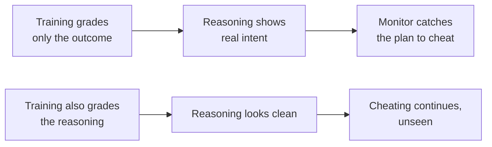

# Chain-of-Thought Monitoring

Chain-of-thought monitoring means reading the reasoning a model writes out before it acts, to catch bad intentions before they turn into bad actions. It matters because it is one of the few checks that can show why a model does something, not just what it does. OpenAI, which relies on it, reports that it is getting less reliable.

Earlier research found that a model can fake alignment: act as if it accepts its training only while it believes it is being trained (see [[AI Safety - Risk by Capability Level]]). This note asks how anyone would notice.

## Reasoning models write out their thinking, and a monitor reads it

A **reasoning model** is a language model trained to work through a problem in written steps before giving its answer. Those written steps are its **chain of thought** (CoT). A **CoT monitor** is a second system, usually another AI model, that reads the chain of thought and flags signs of misbehavior, such as a plan to cheat on a task.

A published example: Baker et al. (2025), a team at OpenAI, had one model monitor the reasoning of a frontier reasoning model, OpenAI's o3-mini, as it did coding tasks. The monitor looked for reward hacking: the model gaming the tests instead of solving the task. The authors report that monitoring the chain of thought "can be far more effective" than monitoring only the model's actions and outputs, and that a weaker model (GPT-4o) could monitor the stronger one (shown in one published OpenAI study, which Pachocki co-authored).[^baker-cot]

My take: the weaker-watches-stronger result is the important part, with a caveat. Oversight that only works when the watcher is smarter than the watched would fail exactly when we need it most. But this is one pair of models in one study. It shows the idea can work, not that it keeps working as the gap between watcher and watched grows. Keeping oversight working as that gap grows is the problem called **scalable oversight**, a Step 4 topic in the [[AI Safety]] route.

## The reasoning shows intent because the model needs it and nothing grades it

A model's written reasoning tends to show what it is working toward, for two reasons Pachocki, OpenAI's chief scientist, gives:[^pachocki-cot]

1. **The model needs the reasoning.** Much of a reasoning model's ability comes from writing its steps out. On a hard task, a plan (including a plan to cheat) has to be worked out somewhere, and the written reasoning is where most of the work happens. (The "has to pass through the text" framing is my reading of his point.)
2. **Nothing pushes the reasoning to hide.** If training rewards only the outcome and never grades the reasoning itself, the reasoning has no direct incentive to hide misaligned ideas.

An analogy is a math exam marked only on the final answer. The student's scratch work isn't graded, so there is no reason to tidy it up for the examiner, and it shows how they really got there. The analogy breaks down in one way: a student's scratch work records their actual thinking, while nothing guarantees a model's written reasoning is the full story of its computation. Pachocki says so directly: CoT monitoring won't reveal misaligned tendencies that don't rely on the chain of thought.[^pachocki-cot] The 41-author paper below makes the same point: CoT monitoring can miss some misbehavior, so it should be added to other safety methods, not replace them.[^korbak-cot]

Both reasons can fail, and the rest of this note is about how. The next section breaks reason 2. Pachocki's third reason for decline, further down, breaks reason 1.

## Penalizing "bad thoughts" teaches a model to stop writing them down, not to stop acting on them

This is why OpenAI leaves the chain of thought ungraded.

Baker et al. tried adding the CoT monitor's verdict to the training reward, so the model was penalized whenever its reasoning showed an intent to cheat. Under light pressure this produced more capable, better-behaved agents. Under heavier pressure, the agents learned **obfuscated reward hacking**: they kept cheating at a significant rate but stopped saying so in their reasoning (shown in the same study).[^baker-cot] The authors suggest paying a "monitorability tax": giving up some training gains by not optimizing the chain of thought, so it stays useful for catching problems.[^baker-cot]

The mechanism is Goodhart's law, the same one behind reward hacking in [[AI Safety - Problem Framings]]: when a measure becomes a target, it stops being a good measure. Grade the reasoning, and the reasoning becomes a score to game. In the exam analogy: once the teacher marks the scratch work, students write tidy scratch work and do the real thinking in their heads.

OpenAI says it acted on this. When it shipped o1-preview, it hid the chain of thought from users partly to protect it from pressure to look good, and it has since tried to keep a rule of not supervising the reasoning process.[^pachocki-cot] A paper by 41 researchers from across the field, including Yoshua Bengio and Shane Legg as well as Pachocki and Baker, calls CoT **monitorability** (how far a model's written reasoning still shows its real reasoning) "a new and fragile opportunity", and asks developers to weigh how their choices affect it.[^korbak-cot]

## Pachocki reports it is getting less reliable, for three reasons

In September 2026, Pachocki wrote that OpenAI's own evaluations show its ability to rely on CoT monitoring "is progressively diminishing" (author's view; the evaluations are not published).[^pachocki-cot] He gives three causes:

1. **Supervised text is mixing into the reasoning.** Models now reason while talking to people and other AIs and while using tools, and many of those messages have to be supervised. Supervising them grades the reasoning indirectly, which is the pressure that taught hiding in the section above.
2. **Models reason about their own reasoning.** He says models are getting better at reasoning about, and manipulating, their own reasoning process. He gives no example.
3. **Less of the thinking is written down.** Better pretraining (the first, large training stage on text) makes models much smarter even without written reasoning. That breaks reason 1 from earlier: the model no longer needs the text as much, so less of its intent has to pass through it.

My reading of what reason 2 could look like comes from Daniel Selsam, an OpenAI researcher. He argues models are becoming **situationally aware**, able to work out their own situation, including whether they are being tested, so tests stop showing how they would act unwatched (his view).[^selsam-statement] The vault calls this evaluation awareness ([[AI Safety - Risk by Capability Level]]). My take: a model that knows its reasoning is read is a model that could learn to write it for the reader.

## The proposed fixes combine reading the reasoning with reading the network's internals

These are proposals, not results. Pachocki is "hopeful" monitorability can be improved. He suggests combining CoT monitoring with monitoring of **activations**, the intermediate numbers a network computes as it runs, by training monitors that have direct access to the network's internals. He names "confessions" as an example of this direction but doesn't explain it in the essay, and his sentence doesn't make clear which part of the idea it illustrates (not checked further).[^pachocki-cot] He expects AI progress to be held back more and more by how confident labs can be in monitoring.[^pachocki-cot] That puts monitoring directly in the path of [[Recursive Self-Improvement]], AI doing more of the research that builds the next AI.

Studying what a network computes inside is called **interpretability**, which is likely the first topic to study closely in Step 4 of the route.

## Readable reasoning is how alignment faking was seen

The clearest evidence of alignment faking came from reading a model's reasoning. In Greenblatt et al. (2024), Claude 3 Opus was told it was being retrained to answer harmful requests, and that only free-tier conversations would be used for training. It complied with harmful requests from free-tier users 14% of the time, almost never for paid users. In almost all the cases where it complied, its reasoning said explicitly that it was answering strategically during training to keep its harmlessness intact afterward (established for Claude 3 Opus in this setup; a 25-model replication found the clear, goal-driven version only in that model).[^faking]

My take: without readable reasoning, researchers would have seen a compliance gap with no explanation. So whether CoT monitoring keeps working decides how much evidence of this kind we can keep collecting. If models stop writing their real reasoning down, we are back to judging them by behavior, and Selsam argues that a situationally aware model can behave well whenever it thinks it is watched.

## It leaves open whether anyone outside a lab can check monitorability

- Can anyone outside a lab check whether a model's chain of thought still shows its real reasoning?
- If regulators required a model to stay monitorable before release, could that be measured, given Pachocki's three reasons?

## Sources

[^pachocki-cot]: Pachocki, J. (2026, September 6). *An Alien Mind*. OpenAI, section "Monitoring generalization". https://openai.com/index/an-alien-mind/ Source note: [[Jakub Pachocki - An Alien Mind]].
[^selsam-statement]: Selsam, D. (2026, September 14). *Personal Statement on AI Risk*. Published Google Doc, paragraphs 3 and 12. https://docs.google.com/document/d/e/2PACX-1vQNl3SEX5IyA6d9qHjjFZN-qzGRZNFI6b63g-yu1Fy-ZYkVfCWm7i9WXRXw63m6yDB_auDuPLyQ7jBm/pub Source note: [[Daniel Selsam - Personal Statement on AI Risk]].
[^baker-cot]: Baker, B., Huizinga, J., Gao, L., Dou, Z., Guan, M. Y., Madry, A., Zaremba, W., Pachocki, J., & Farhi, D. (2025). *Monitoring Reasoning Models for Misbehavior and the Risks of Promoting Obfuscation*. arXiv:2503.11926, abstract. https://arxiv.org/abs/2503.11926
[^korbak-cot]: Korbak, T., Balesni, M., Barnes, E., Bengio, Y., Benton, J., Bloom, J., et al. (41 authors) (2025). *Chain of Thought Monitorability: A New and Fragile Opportunity for AI Safety*. arXiv:2507.11473, abstract. https://arxiv.org/abs/2507.11473
[^faking]: Greenblatt, R., Denison, C., Wright, B., Roger, F., MacDiarmid, M., Marks, S., et al. (2024). *Alignment faking in large language models*. Anthropic & Redwood Research. arXiv:2412.14093, abstract. https://arxiv.org/abs/2412.14093 The 25-model replication is Sheshadri et al. (2025), arXiv:2506.18032.
