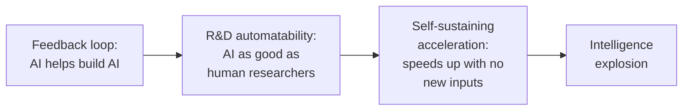

# Intelligence Explosion

An intelligence explosion is a stretch of time in which AI improving AI makes capability grow faster and faster, instead of at a steady pace. Whether one happens depends less on whether AI helps with AI research, which it already does, than on how strong that help is compared with what holds it back. It matters for safety because a fast run-up would leave little time to check each new system before the next one arrives. How fast it happens is called **takeoff speed**. In the strict sense used by the Elasticity Institute paper below, an explosion means capability going to infinity in finite time; the looser "faster and faster" sense is what that paper calls self-sustaining acceleration, and this note uses the paper's terms from the table on.

This note builds on [[Recursive Self-Improvement]], which covers AI doing more of the work of building AI. Here the question is when that loop runs away.

## Good's 1965 argument: a machine that designs machines could design better ones

The idea goes back to the statistician I. J. Good. If a machine could surpass humans at all intellectual work, then, since designing machines is intellectual work, it could design even better machines, and "there would then unquestionably be an 'intelligence explosion'" (Good, 1965, as quoted by the course).[^lesson-2-3][^good]

Where this could end up is **superintelligence**, which the course defines, following Nick Bostrom, as "any intellect that greatly exceeds the cognitive performance of humans in virtually all domains of interest".[^lesson-2-3]

Good's "unquestionably" is the part economists dispute. A loop existing doesn't make it explode, as the rest of this note explains.

## Four ideas get blurred together under "RSI"

The Elasticity Institute paper separates four things people often treat as one (paraphrased):[^cunningham-rsi]

| Idea | What it means | Is it happening? |
| --- | --- | --- |
| Feedback loop | Today's outputs become tomorrow's inputs, as when AI helps write the code for the next AI | Yes, and for a long time |
| R&D automatability | AI can make research improvements as good as human researchers' at equal cost (whether or not labs actually let it) | Not yet: AI "leads" about a quarter of Anthropic's research work, per Anthropic ([[Recursive Self-Improvement]]) |
| Self-sustaining acceleration | AI alone keeps progress speeding up, with no more human researchers or compute added | Not yet, by the paper's rough estimate |
| Intelligence explosion | Capability heads toward infinity in finite time | No one claims it has happened |

Each step needs more than the one before. Full automation of research is not enough on its own: the paper's models show an explosion "may not follow" if each new idea gets harder to find or a bottleneck binds (established within the paper's models).[^cunningham-rsi]

## Whether the loop runs away depends on three numbers per round

The course puts the condition simply: what matters is "how much each round improves capabilities, how much it needs in terms of resources and how long that round takes".[^lesson-2-3]

An analogy is a nuclear chain reaction. If each split atom triggers more than one further split on average, the reaction grows. If fewer than one, it fizzles. AI progress is similar: if each gain in capability produces a larger gain in research output, progress speeds up; if smaller, it slows toward a steady pace. The analogy breaks down in one place. In physics the multiplication factor is well understood and measured, while for AI it changes as models improve and nobody can measure it directly yet.

The economists' version of the first number asks how strongly one quantity responds to another, an **elasticity**. Compute and the time to train, in the brakes table below, are the other two. Their central question: "for a one-unit increase in model capabilities, how much do the capabilities of the next generation of models increase?"[^cunningham-rsi]

## The 2026 estimate: below the threshold, but rising

The paper puts a rough number on it (authors' back-of-the-envelope calculation):[^cunningham-rsi]

- Self-sustaining acceleration needs research productivity to rise by more than about 15% for each point on the Epoch Capabilities Index, a combined capability scale ([[Measuring AI Capability]]).
- Over the past two years, even taking Anthropic engineers' self-reported 4x uplift at face value, which the authors call "very likely to be an overestimate", the figure is about 9% per point. That is below the threshold. To check the arithmetic: a 4x gain spread over 16 index points is about 9% per point compounded, while 15% per point over 16 points would have needed about 9x.
- But the response seems to be growing: going from GPT-4 to GPT-5 raised research productivity far more than going from GPT-1 to GPT-2.

How sure to be: the authors say they have "almost no evidence" for the key elasticity, so this is a first estimate, not a measurement.

## Uplift is the quantity to watch

**Uplift** is how many times faster AI makes a researcher or engineer: 2x uplift means work that took two days takes one. The AI Futures Project now forecasts from it.[^aifutures-q25] Its simple model has three inputs: today's uplift, how fast (uplift minus 1) doubles, and the uplift at which AI could replace a lab's software engineers, a milestone it calls the **Automated Coder**. Uplift of 1x means no help, so uplift minus 1 is the extra speed AI adds: 1 at 2x, 19 at 20x. The milestone matters here because Daniel Kokotajlo's model puts superintelligence 1.2 to 1.7 years after it.[^aifutures-q25]

A worked example with Daniel Kokotajlo's median inputs: today's uplift 2x, so (uplift minus 1) is 1. The target is 20x, so it must reach 19, about 4.25 doublings. At one doubling every 5 months, that is about 21 months from August 2026, around May 2028, the date the authors' app gives. With a 3.6-month doubling, which the authors also discuss, it is about 15 months, around November 2027.[^aifutures-q25] One input moves the answer by half a year. Daniel's own forecast, November or December 2027 (the post's charts give both), is earlier than May 2028 because his full model lets the doubling time shorten as more coding is automated, and he adds his judgment on top. Its closeness to the 3.6-month result is a coincidence.

The evidence for today's uplift ranges from about 1.04x (a METR study) to 4x (an Anthropic survey of its own staff); Daniel's median is 2x.[^aifutures-q25] Claude's take (not yet discussed): that spread makes the starting point the weakest input. A related measure, the share of research work AI leads at Anthropic, is in [[Recursive Self-Improvement]]; the course notes that a naive extrapolation would have AI leading most of that work during 2027, but that the remaining tasks may be harder and extending a short trend is "highly uncertain".[^lesson-2-3]

## Several things could stop the loop

The bottlenecks named by lab insiders are in [[Recursive Self-Improvement]]; this table collects the lesson 2.3 readings' list.

| Brake | How it would work | Source |
| --- | --- | --- |
| Compute | More AI researchers still need compute for experiments; better algorithms may need more training compute; the economy may not grow fast enough to pay | Elasticity paper, section 4.2[^cunningham-rsi] |
| Diminishing returns | Each improvement gets harder to find, which the paper says is "widely observed informally" | Same |
| Data | Much algorithmic progress may come from better data, which may not scale the same way | Same |
| Time to train | Applying a software improvement needs a new training run, which slows the fastest takeoffs | AI Futures update[^aifutures-q25] |
| Research taste | Choosing worthwhile questions and knowing when to drop an approach may stay hard to automate | Course; AI 2027[^lesson-2-3][^ai2027] |
| Politics | Data center cancellations and policy reactions could slow scaling | Elasticity paper, section 4.2[^cunningham-rsi] |

## Research taste may be the hardest brake to release

**Research taste** is the judgment part of research: "choosing worthwhile questions, interpreting results and knowing when to abandon/double-down on an approach", in the course's words.[^lesson-2-3] The lesson says AI still struggles with it, and that whether and how soon this is solved "is less clear" (course's view).

Why it is hard to train, per AI 2027: "longer feedback loops and less data availability". You find out whether a research direction was good months later, so there are few clear signals to learn from.[^ai2027] Claude's take (not yet discussed): that is the verifiability problem from [[Drivers of AI Progress]]: what can't be checked quickly can't be trained quickly.

The Elasticity paper frames the same worry as **narrow before broad**: AI might speed up concrete, benchmark-measured algorithmic gains while staying weak at the breakthroughs and "amorphous" skills like "vision" or "taste" that broader progress needs.[^cunningham-rsi] METR's 2026 finding that agents are strong on checkable tasks and weak on judgment points the same way ([[Measuring AI Capability]]).

Claude's take (not yet discussed): even without solving taste, automating the rest of research shortens each cycle, which the course also says is "very likely".[^lesson-2-3] So taste may slow the loop more than stop it.

## AI 2027 shows a run-away, with the brakes visible

AI 2027 is a scenario in which this loop runs from 2025 to late 2027.[^ai2027] Its AI R&D progress multiplier, how much faster the whole lab's algorithmic progress goes (not one engineer's uplift), climbs from 1.5x in early 2026 to about 50x by September 2027. Two details show the brakes even in a fast story:

- In March 2027, 200,000 copies of a superhuman coder, equal to 50,000 top coders working 30 times faster (about 1.5 million coder-equivalents), speed progress up "only" 4x, because of "bottlenecks and diminishing returns to coding labor".
- In September 2027, 300,000 copies, each thinking about 50 times faster than a human and each better at AI research than any human, still speed progress only about 50x, because the lab is "heavily bottlenecked on compute to run experiments".

Its authors later judged reality to be moving at about 70 to 90% of the scenario's pace (their own grading).[^aifutures-q25] The full story is in [[Kokotajlo et al - AI 2027]].

## A fast acceleration matters even if it never becomes infinite

The Elasticity paper lists what makes a rapid acceleration different from ordinary progress (authors' view):[^cunningham-rsi]

- costs of adjusting, such as job changes, rise with speed;
- institutions such as regulators and courts may lag, and those in power may use the moment to capture them;
- progress may be very uneven, with fast gains where results are easy to check and slow ones elsewhere;
- small leads between labs or countries could become large gaps in power;
- misalignment risk grows, because sudden jumps leave "less time for technical and social safeguards".

AI 2027 shows the oversight version of that last point: "What Agent-3 does in a day takes humans several days to double-check."[^ai2027] That connects directly to [[Chain-of-Thought Monitoring]] and [[Rogue Deployments]].

## Forecasts differ by years

- The AI Futures Project's all-things-considered medians for the Automated Coder, as of August 2026: Daniel Kokotajlo November 2027, Brendan Halstead January 2029, Eli Lifland January 2030. These assume things go as fast as technically feasible, with no deliberate slowdown.[^aifutures-q25]
- In August 2025, experts and superforecasters gave an 8 to 20% chance that the growth rate of effective compute would triple by 2029. In May 2026, Jack Clark gave a 60% chance that by the end of 2028 there will be AI that could "autonomously build its own successor" (both as cited by the Elasticity paper).[^cunningham-rsi]

How these forecasts are made, and how well past ones held up, is in [[AI Timelines]].

## Open questions

- Can research taste be trained, or does it need something new?
- What measurement would show the loop crossing the self-sustaining threshold, and who would see it first?

## Sources

[^lesson-2-3]: BlueDot Impact. *AGI Strategy, Unit 2: How could progress accelerate from here?* Accessed 2026-10-22. https://bluedot.org/courses/agi-strategy/2/3 Quotes Good (1965) and Bostrom's definition of superintelligence; cites Anthropic for the 26% figure.
[^good]: Good, I. J. *Speculations Concerning the First Ultraintelligent Machine*. Advances in Computers, 6, 31-88. Crossref lists the volume as 1966; the essay is often cited as 1965. https://doi.org/10.1016/S0065-2458(08)60418-0
[^cunningham-rsi]: Cunningham, T., et al. (2026, July 13). *The Economics of Recursive Self-Improvement*. Elasticity Institute, pages 2-3, 29 and sections 4.2-4.3. https://elasticity.institute/rsi-paper.pdf Source note: [[Cunningham et al - The Economics of Recursive Self-Improvement]].
[^aifutures-q25]: Lifland, E., Kokotajlo, D., & Halstead, B. (2026, August 17). *Q2.5 2026 Timelines Update: Uplift and Revenue*. AI Futures Project blog. https://blog.aifutures.org/p/q25-2026-timelines-update-uplift Source note: [[Lifland, Kokotajlo and Halstead - Q2.5 2026 Timelines Update]].
[^ai2027]: Kokotajlo, D., Alexander, S., Larsen, T., Lifland, E., & Dean, R. (2025, April 3). *AI 2027*. AI Futures Project, sections "March 2027", "April 2027" and "September 2027". https://ai-2027.com/ Source note: [[Kokotajlo et al - AI 2027]].
