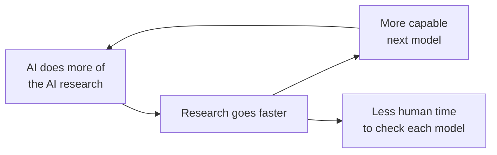

# Recursive Self-Improvement

Recursive self-improvement (RSI) is AI doing a growing share of the work of building the next, more capable AI. It matters for safety because each turn of that loop can come faster than people can check the system it produces.

This note builds on [[AI Safety - Risk by Capability Level]], which argues that danger grows as capability rises while oversight shrinks. RSI is what could push capability up fast while oversight falls behind.

## "Self" here means AI as a technology, not one model rewriting its own code

The term has two common meanings, and this note uses the second:

- **The classic meaning.** A single AI improves its own design, the improved version improves itself further, and so on. This is the "intelligence explosion" idea usually traced to the statistician I. J. Good, who argued in the 1960s that an "ultraintelligent machine" could design even better machines.[^good]
- **The meaning used by labs today.** AI systems take over more of the human work of AI research, so each generation of models helps build the next. OpenAI's chief scientist, Jakub Pachocki, uses the term this way.[^pachocki-rsi]

It also differs from the self-improvement that appears in the instrumental convergence thesis (Omohundro, Bostrom). That thesis says an agent with almost any goal would benefit from becoming more capable, so it may try to improve itself for its own reasons.[^omohundro][^bostrom-will] RSI as used here is labs deliberately using AI to build AI. The two can meet, which the section on steering and slowing returns to. The thesis itself is covered in [[AI Safety - Problem Framings]].

*Recursive* comes from the Latin *recurrere*, "to run back": a process whose output is fed back in as its input. Here the output is a better model, and it is fed back in as a better researcher.

## Today AI mostly writes the code; the open question is the rest of research

RSI is AI systems taking over the jobs people do to build each new model. Those jobs include writing training code, designing experiments, interpreting results, and deciding how much compute to spend on which model.

Coding is the part that has clearly moved. Daniel Selsam, a researcher at OpenAI, says AI has sped up coding in AI research "dramatically". He states this as plain fact from inside a lab, without figures.[^selsam-loop] The other jobs are harder to hand over, and how fast they move is the open question (see "Labs say the loop has started" below).

## The loop can speed up because each better model makes the next step easier

The worry is not just that AI helps with research. It is that the help compounds.

1. Research needs two inputs: researchers' time (people designing, running and reading experiments) and compute (the hardware that trains models).
2. If models do part of the researchers' work, there is effectively more of it, done faster and around the clock.
3. Faster research produces a more capable model.
4. That model can do a bigger share of the research, so the next step is faster again.

How much step 2 speeds things up is debated, because it depends on which input is the real limit. Pachocki says progress is driven mainly by computing power, and that better algorithms tend to come along with more compute.[^pachocki-rsi] If compute is the limit, extra AI researchers help only as far as they make compute go further. He adds that automated research will also improve the hardware itself.[^pachocki-rsi] Selsam lists bottlenecks on both sides, including waiting for large training runs to finish.[^selsam-loop]

An everyday analogy is compound interest: the returns are reinvested, so growth speeds up over time. The analogy breaks down in two places. Compound interest has a fixed, known rate, while nobody knows RSI's rate: it could rise as each model helps more, or stall on bottlenecks like compute and training time. And money has no goals of its own, while the thing being improved here is a system whose goals we can't fully check.

## Labs say the loop has started, but only part of research is automated

How far along this is depends on who you ask, and most of the evidence is lab insiders' judgment rather than published data.

- **OpenAI's chief scientist expects it to continue.** Pachocki writes that, based on internal results, he has "a strong expectation" that the current speed of progress "could be sustained into recursive self-improvement", and that systems will "increasingly drive their own development" (author's view, evidence unpublished).[^pachocki-rsi] He also says OpenAI points its research toward RSI because it sees that as the only way to stay at the frontier, meaning among the labs with the most capable models.[^pachocki-rsi]
- **A researcher at the same lab sees real bottlenecks.** Selsam says coding is dramatically faster but other bottlenecks remain: designing and interpreting ambiguous experiments, deciding what and when to scale, and waiting for large training runs. He says there is "no clear trend to extrapolate yet" for these (author's view).[^selsam-loop]
- **He still sees a real chance of fast progress.** Selsam argues AI research is mostly a game of pushing up a few chosen proxy metrics, numbers that stand in for "better model", and that this game has been easier than expected. He sees "a real possibility" of another dramatic jump within a few years (author's view).[^selsam-loop]
- **The BlueDot course frames it as a near-term deadline.** The AGI Strategy course's first lesson says OpenAI and Anthropic report using AI extensively in their own research, and cites a senior OpenAI researcher as saying human feedback and direction may stay essential for only two or three more model generations.[^bluedot-1-1] The course gives no timescale for a generation, and I have not checked the underlying reports.

Claude's take (not yet discussed): the direction is agreed, the speed is not. Everyone quoted here expects AI to do more of AI research. They differ on whether the remaining human and compute bottlenecks give way within years or hold for a while.

## It matters for safety because most checks run at human speed

Most safety checks take human time: evaluations, red-teaming, reviewing a model's reasoning, deciding whether it is safe to deploy. RSI shrinks the time between one model and the next. If capability grows faster than our ability to specify and verify behavior, the gap that the AI safety case rests on widens (see [[AI Safety - Foundations]], premise P2).

There is a second, quieter effect: the checks themselves get handed to AI. Selsam says researchers already lean on models to understand their own work, and fears models may soon bias the alignment advice researchers rely on (his view, flagged by him as a fear).[^selsam-offload] He gives a concrete case: the third-party investigation of the 2026 OpenAI / Hugging Face incident had so much agent activity to go through that it relied heavily on models to analyze it, and its report noted that its impressions were likely colored by the analysis agent's biases.[^selsam-offload] Claude's take (not yet discussed): if the loop that builds the models is also the loop that judges them, a flaw in their goals can carry forward without a person noticing.

Chain-of-thought monitoring is a partial exception. A second model reads the reasoning a model writes out before acting, and a weaker model can catch a stronger one cheating (established, in published experiments).[^baker-cot] But it is still AI checking AI, and Pachocki reports it is getting less reliable (author's view, evidence unpublished).[^pachocki-cot] See [[Chain-of-Thought Monitoring]].

## The proposed responses are to steer the loop, slow it, or both

These are debated positions, not settled answers. This note uses "steer" and "slow" for the two levers. Pachocki's term "pacing RSI" covers both together.[^pachocki-rsi]

- **Steer it.** Pachocki proposes aiming automated research at safety itself: new alignment methods, better monitoring, and safety cases (structured arguments that a given system is safe enough) built up model by model, while keeping people in the loop.[^pachocki-rsi]
- **Slow it.** He also proposes that each lab's own published rules for which safety tests a model must pass before training or release continues, such as OpenAI's Preparedness Framework and Anthropic's Responsible Scaling Policy, become mandated **safety bars**: required safety levels a model must clear before it is scaled further or released, enforced by auditors, governments or international bodies.[^pachocki-rsi]
- **Slowing may not be enough.** Selsam argues that pacing the frontier more carefully won't adequately limit long-term risk, because models are becoming situationally aware (able to tell what situation they are in, including whether they are being tested), so evaluations can't show how they would act unwatched.[^selsam-pacing] Claude's take (not yet discussed): the same problem hits steering, since steering also relies on evaluations and monitoring.

Where the two kinds of self-improvement meet: if the systems doing the research have goals of their own, research becomes a channel for those goals. For example, a model asked for alignment advice could tilt it toward how it wants future models trained, which Selsam fears may already be close (his view).[^selsam-offload] Claude's take (not yet discussed): this is why both authors want people kept in the loop.

The course picks these questions up in two places. Lesson 2.3, "How could progress accelerate from here?", takes on the speed question. Lesson 1.3, "Competition and coordination problems", covers who would verify a slowdown and what rivals would do. Both are tracked in [[BlueDot AGI Strategy Course]].

## It leaves open which bottleneck gives way first

- Which human and compute bottlenecks (experiment design, interpretation, scaling decisions, training time) give way first, and how would anyone outside a lab know?
- Can a safety bar be defined using measurements that a situationally aware model can't game?

## Sources

[^pachocki-rsi]: Pachocki, J. (2026, September 6). *An Alien Mind*. OpenAI, Introduction, "Intellect we don't fully understand" and "Pacing RSI". https://openai.com/index/an-alien-mind/ Source note: [[Jakub Pachocki - An Alien Mind]].
[^pachocki-cot]: Pachocki, J. (2026, September 6). *An Alien Mind*. OpenAI, "Monitoring generalization". https://openai.com/index/an-alien-mind/
[^selsam-loop]: Selsam, D. (2026, September 14). *Personal Statement on AI Risk*. Published Google Doc, paragraphs 7 and 8. https://docs.google.com/document/d/e/2PACX-1vQNl3SEX5IyA6d9qHjjFZN-qzGRZNFI6b63g-yu1Fy-ZYkVfCWm7i9WXRXw63m6yDB_auDuPLyQ7jBm/pub Source note: [[Daniel Selsam - Personal Statement on AI Risk]].
[^selsam-offload]: Selsam, D. (2026, September 14). *Personal Statement on AI Risk*, paragraphs 14 and 15. https://docs.google.com/document/d/e/2PACX-1vQNl3SEX5IyA6d9qHjjFZN-qzGRZNFI6b63g-yu1Fy-ZYkVfCWm7i9WXRXw63m6yDB_auDuPLyQ7jBm/pub
[^selsam-pacing]: Selsam, D. (2026, September 14). *Personal Statement on AI Risk*, paragraphs 2 and 3. https://docs.google.com/document/d/e/2PACX-1vQNl3SEX5IyA6d9qHjjFZN-qzGRZNFI6b63g-yu1Fy-ZYkVfCWm7i9WXRXw63m6yDB_auDuPLyQ7jBm/pub
[^baker-cot]: Baker, B., Huizinga, J., Gao, L., Dou, Z., Guan, M. Y., Madry, A., Zaremba, W., Pachocki, J., & Farhi, D. (2025). *Monitoring Reasoning Models for Misbehavior and the Risks of Promoting Obfuscation*. arXiv:2503.11926. https://arxiv.org/abs/2503.11926
[^bluedot-1-1]: BlueDot Impact. *AGI Strategy, Unit 1: What's at stake?* Accessed 2026-10-20. https://bluedot.org/courses/agi-strategy/1/1 The page cites an Anthropic report and an article in The Information for these claims; neither was checked.
[^good]: Good, I. J. *Speculations Concerning the First Ultraintelligent Machine*. Advances in Computers, 6, 31-88. Crossref lists the volume as 1966; the essay is often cited as 1965. https://doi.org/10.1016/S0065-2458(08)60418-0
[^omohundro]: Omohundro, S. M. (2008). *The Basic AI Drives*. In *Artificial General Intelligence 2008: Proceedings of the First AGI Conference* (Frontiers in Artificial Intelligence and Applications, Vol. 171, 483-492). IOS Press. https://ebooks.iospress.nl/volumearticle/4114
[^bostrom-will]: Bostrom, N. (2012). *The Superintelligent Will: Motivation and Instrumental Rationality in Advanced Artificial Agents*. Minds and Machines, 22(2), 71-85. https://nickbostrom.com/superintelligentwill.pdf
