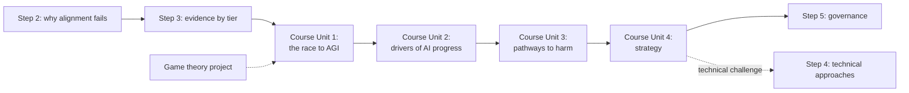

# BlueDot AGI Strategy Course

Hub for working through BlueDot Impact's **AGI Strategy** course.[^course] Workflow: I read each lesson and either discuss it or say "ingest", which writes a source note for each reading and pulls its ideas into concept notes. This page tracks progress, my exercise answers, and how the course plugs into my [[AI Safety]] route.

## The course's question

How can humanity realize the benefits of powerful AI while keeping control over its development and our future?[^course]

## How it fits my AI safety route

My route so far has been technical-first: [[AI Safety - Foundations|Step 1]] (the map), [[AI Safety - Problem Framings|Step 2]] (why alignment fails), [[AI Safety - Risk by Capability Level|Step 3]] (evidence by capability tier). This course is mostly **strategy and governance**, which is Step 5 on the hub. Doing it now means I meet Step 5 before Step 4.

That is a fine order, as long as I keep the link explicit: the course keeps asking "what should actors do?", and the honest answer often depends on Step 4 questions ("can we actually verify a model is safe?"). When a unit leans on a technical claim, I note it as a Step 4 thread to pull on later.

It also overlaps my [[Game Theory and Strategic Interaction]] project. The racing dynamic in Unit 1 is a prisoner's dilemma, and the fixes (agreements, verification, changing payoffs) are game theory's standard escape routes.

## Curriculum and progress

Durations are the course's estimates.[^course]

Course pages are reading lists, so they get no source note of their own. Each reading gets a source note, and its ideas go into concept notes.

Order I'm taking it in: after lesson 1.1, I paused Unit 1 on 2026-10-21 and jumped to Unit 2, to prepare for that night's live session on Unit 2. I'll come back to lessons 1.2 to 1.4 after Unit 2. Unit 2 builds only on lesson 1.1, so taking it early should lose little (my judgment).

### Unit 1: The race to AGI

- [x] 1.1 What's at stake? (30 min), ingested 2026-10-20
  - Core reading: Daniel Selsam, "Personal Statement on AI Risk" (2026). Source note: [[Daniel Selsam - Personal Statement on AI Risk]]. The course asks which step of his argument you would investigate before agreeing with it.
  - Recommended by the lesson: Jakub Pachocki, "An Alien Mind" (OpenAI, 2026). Source note: [[Jakub Pachocki - An Alien Mind]].
  - Ideas pulled out: [[Recursive Self-Improvement]], [[Chain-of-Thought Monitoring]], evaluation awareness and the 2026 agent incidents in [[AI Safety - Risk by Capability Level]], goal vs value alignment in [[AI Safety - Problem Framings]].
  - Optional readings listed, not yet read: Holden Karnofsky, "The Most Important Century" in a nutshell; Dario Amodei, "Machines of Loving Grace"; Forethought, "Introducing Better Futures"; Sam Altman, "The Gentle Singularity"; Bill Gates, "A turbulent AI era and critical choices to make".[^lesson-1-1]
- [ ] 1.2 What future do you want? (16 min, exercise)
- [ ] 1.3 Competition and coordination problems (45 min)
- [ ] 1.4 Responding to the Hugging Face incident (45 min, exercise)

### Unit 2: Drivers of AI progress

- [x] 2.1 What drives AI progress? (50 min), ingested 2026-10-21
  - Core reading: Benjamin Todd, "Will we have AGI by 2030?" (80,000 Hours, 2025; the course calls it "The case for AGI by 2030"). Source note: [[Benjamin Todd - Will We Have AGI by 2030]]. The lesson also quotes Todd's September 2026 scoring of his own forecasts, recorded in that note.
  - Core reading: David Owen, "What will AI look like in 2030?" (Epoch AI, 2025). Source note: [[David Owen - What Will AI Look Like in 2030]].
  - Ideas pulled out: [[Drivers of AI Progress]], [[AI Timelines]], and why AI research may be automated first in [[Recursive Self-Improvement]].
  - The lesson's prompt, where to place today's models in Todd's 2025 picture, is in [[Open Questions]].
  - Optional readings listed, not yet read: Epoch AI, "Can AI scaling continue through 2030?"; Kaplan et al., "Scaling Laws for Neural Language Models" (arXiv:2001.08361); Villalobos et al., "Will we run out of data? Limits of LLM scaling based on human-generated data" (arXiv:2211.04325); Epoch AI, "The case for multi-decade AI timelines"; "The state of AI safety in four fake graphs" (Windows on Theory, 2026); a Dwarkesh Patel podcast with Dario Amodei.[^lesson-2-1]
- [x] 2.2 What can increasingly capable AI systems do? (1h 15min), ingested 2026-10-22
  - Reading: METR, "Frontier Risk Report (February to March 2026)" (2026). Source note: [[METR - Frontier Risk Report February to March 2026]]. The lesson assigns the first "Means" subsection and the judgment section through Table 3, and asks what distinguishes the tasks agents do well from those they struggle with.
  - Reading: Marina Favaro and Phillie Wright, "Measurements for understanding the pace of AI development inside frontier labs" (Anthropic, 2026). Source note: [[Favaro and Wright - Measurements for Understanding the Pace of AI Development]]. The lesson assigns section 1, footnote 1, and the appendix on AI-led R&D.
  - Reference pages, used in concept notes rather than given source notes: Epoch AI's "Trends in AI" dashboard, the Epoch Capabilities Index, and Epoch's benchmark directory.
  - Ideas pulled out: [[Measuring AI Capability]], [[Rogue Deployments]], plus updates to [[Recursive Self-Improvement]], [[Chain-of-Thought Monitoring]], [[Drivers of AI Progress]], [[AI Timelines]] and [[AI Safety - Risk by Capability Level]].
  - Suggested practice: push AI systems to their limits yourself (the course suggests Claude Code or Codex), and try forecasting on Metaculus's AI 2027 question series. Both are in [[Ideas]]. The lesson's ECI comparison prompt is in [[Open Questions]].
  - Optional readings listed, not yet read: "PaperBench: Evaluating AI's Ability to Replicate AI Research" (Starace et al., 2025); "Vending-Bench 2" (Andon Labs, 2025); "OpenAI's GPT-6 Astra on ARC-AGI-3" (ARC Prize, 2026); "What a 100-year-old horse teaches us about AI" (Rational Animations, 2025, on why high benchmark scores can mislead).[^lesson-2-2]
- [ ] 2.3 How could progress accelerate from here? (1h 30min)

### Unit 3: Pathways to harm

- [ ] 3.1 Pathways to harm
- [ ] 3.2 Loss of control (2h 5min)
- [ ] 3.3 Authoritarianism (35 min)
- [ ] 3.4 Biological misuse (50 min)
- [ ] 3.5 Bring the arguments together (25 min)

### Unit 4: Strategy

- [ ] 4.1 Orienting to the strategy (10 min)
- [ ] 4.2 The technical challenge (1h 40min)
- [ ] 4.3 Following the transition (1h)
- [ ] 4.4 Pacing and alternative strategies (40 min)
- [ ] 4.5 Examining the objections (35 min)
- [ ] 4.6 Your assessment of the situation (20 min)

### Unit 5: Your contribution

- [ ] 5.1 Choose your focus (35 min)
- [ ] 5.2 Go deep in one area (1h)
- [ ] 5.3 Make a plan (1h 10min)
- [ ] 5.4 Create your 1-pager (optional)
- [ ] 5.5 Optional advice (2h)
- [ ] 5.6 Next steps: deeper-dive courses
- [ ] 5.7 Next steps: programs

Unit titles for 2 to 5 are my labels from the lesson list; the course names Unit 1 "The race to AGI".

## Where to focus

- **Unit 3.2, Loss of control (2h 5min)** is the longest lesson and the direct continuation of my Step 3 Tier 3. Give it the most attention.
- **Unit 4.2, The technical challenge** is where the course touches Step 4. Use it to decide whether my first Step 4 topic should still be mechanistic interpretability, or AI control and evals given the Hugging Face incident.
- **Unit 5** is the "what do I actually do" unit. It ties back to my reason for studying this: work I can do now and get hired for.

## Questions the course raises go to Thinking

Questions from lessons and readings, including the course's own prompts, are collected in [[Open Questions]], and ideas in [[Ideas]]. Lesson 1.1's prompt about Selsam's argument is the first entry.

## My exercise answers

### 1.2 What could AI help make better?

_Not yet written._

### 1.2 What do we want to preserve?

_Not yet written._

### 1.4 What should your actor do next?

Role chosen: _not yet chosen._

_Not yet written._

## Sources

[^course]: BlueDot Impact. *AGI Strategy* (course). Accessed 2026-10-17. https://bluedot.org/courses/agi-strategy
[^lesson-1-1]: BlueDot Impact. *AGI Strategy, Unit 1: What's at stake?* Accessed 2026-10-20. https://bluedot.org/courses/agi-strategy/1/1
[^lesson-2-1]: BlueDot Impact. *AGI Strategy, Unit 2: What drives AI progress?* Accessed 2026-10-21. https://bluedot.org/courses/agi-strategy/2/1
[^lesson-2-2]: BlueDot Impact. *AGI Strategy, Unit 2: What can increasingly capable AI systems do?* Accessed 2026-10-22. https://bluedot.org/courses/agi-strategy/2/2
