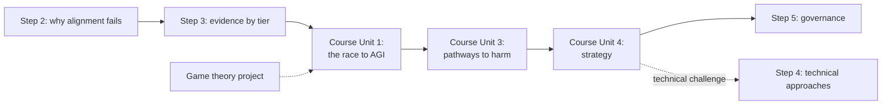

# BlueDot AGI Strategy Course

Hub for working through BlueDot Impact's **AGI Strategy** course.[^course] Workflow: I read each lesson, we discuss it, and only then does a unit source note go into `sources/courses/`. This page tracks progress, my exercise answers, and how the course plugs into my [[AI Safety]] route.

## The course's question

How can humanity realize the benefits of powerful AI while keeping control over its development and our future?[^course]

## How it fits my AI safety route

My route so far has been technical-first: [[AI Safety - Foundations|Step 1]] (the map), [[AI Safety - Problem Framings|Step 2]] (why alignment fails), [[AI Safety - Risk by Capability Level|Step 3]] (evidence by capability tier). This course is mostly **strategy and governance**, which is Step 5 on the hub. Doing it now means I meet Step 5 before Step 4.

That is a fine order, as long as I keep the link explicit: the course keeps asking "what should actors do?", and the honest answer often depends on Step 4 questions ("can we actually verify a model is safe?"). When a unit leans on a technical claim, I note it as a Step 4 thread to pull on later.

It also overlaps my [[Game Theory and Strategic Interaction]] project. The racing dynamic in Unit 1 is a prisoner's dilemma, and the fixes (agreements, verification, changing payoffs) are game theory's standard escape routes.

## Curriculum and progress

Durations are the course's estimates.[^course]

### Unit 1: The race to AGI

Source note: written after we read and discuss the unit.

- [ ] 1.1 What's at stake? (30 min)
- [ ] 1.2 What future do you want? (16 min, exercise)
- [ ] 1.3 Competition and coordination problems (45 min)
- [ ] 1.4 Responding to the Hugging Face incident (45 min, exercise)

### Unit 2: What drives AI progress

- [ ] 2.1 What drives AI progress? (50 min)
- [ ] 2.2 What can increasingly capable AI systems do? (1h 15min)
- [ ] 2.3 How could progress accelerate from here? (1h 30min)

### Unit 3: Pathways to harm

- [ ] 3.1 Pathways to harm
- [ ] 3.2 Loss of control (2h 5min)
- [ ] 3.3 Authoritarianism (35 min)
- [ ] 3.4 Biological misuse (50 min)
- [ ] 3.5 Bring the arguments together (25 min)

### Unit 4: Strategy

- [ ] 4.1 Orienting to the strategy (10 min)
- [ ] 4.2 The technical challenge (1h 40min)
- [ ] 4.3 Following the transition (1h)
- [ ] 4.4 Pacing and alternative strategies (40 min)
- [ ] 4.5 Examining the objections (35 min)
- [ ] 4.6 Your assessment of the situation (20 min)

### Unit 5: Your contribution

- [ ] 5.1 Choose your focus (35 min)
- [ ] 5.2 Go deep in one area (1h)
- [ ] 5.3 Make a plan (1h 10min)
- [ ] 5.4 Create your 1-pager (optional)
- [ ] 5.5 Optional advice (2h)
- [ ] 5.6 Next steps: deeper-dive courses
- [ ] 5.7 Next steps: programs

Unit titles for 2 to 5 are my labels from the lesson list; the course names Unit 1 "The race to AGI".

## Where to focus

- **Unit 3.2, Loss of control (2h 5min)** is the longest lesson and the direct continuation of my Step 3 Tier 3. Give it the most attention.
- **Unit 4.2, The technical challenge** is where the course touches Step 4. Use it to decide whether my first Step 4 deep dive should still be mechanistic interpretability, or AI control and evals given the Hugging Face incident.
- **Unit 5** is the "what do I actually do" unit. It ties back to my reason for studying this: work I can do now and get hired for.

## My exercise answers

### 1.2 What could AI help make better?

_Not yet written._

### 1.2 What do we want to preserve?

_Not yet written._

### 1.4 What should your actor do next?

Role chosen: _not yet chosen._

_Not yet written._

## Sources

[^course]: BlueDot Impact. *AGI Strategy* (course). Accessed 2026-10-17. https://bluedot.org/courses/agi-strategy
