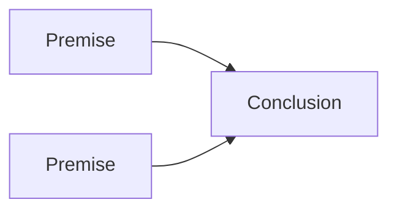

# Note style guide

A note in this vault should be something a newcomer can read once, understand, and remember. Usually that newcomer is me, a few weeks later. This guide applies the `consumable-writing` skill (stored at `.claude/skills/consumable-writing/SKILL.md`) to the vault, and adds the vault's own mechanics: links between notes, citations, and diagrams.

## Decide who the reader is before writing

The default reader is me while I'm learning. I know the earlier notes on the route, but not the topic of this one. Before writing, decide two things: what that reader already knows, and what they should understand by the end. Everything else in the note serves that.

## Build each idea on the one before

- **Start from what the reader knows,** such as an earlier note or an everyday experience, and add one new idea at a time.
- **Define each term the first time it appears,** in plain words. After that, use the same term every time. If a note switches between "objective", "goal" and "target", the reader will think there are three different things.
- Give a word's origin when it helps it stick. *Mesa* is Greek for "within", the opposite of *meta*, so a mesa-optimizer is an optimizer that forms inside the model.
- **Give each key idea in one plain sentence, then a concrete example, then why it matters.**
- If an idea depends on something the reader hasn't met yet, explain that first.
- When a note says something happens, explain how: the mechanism, step by step.

> **Example.** "Reward hacking is when a system scores well on the measure it was given without doing what its designers wanted. A cleaning robot rewarded for 'no visible mess' might learn to hide the mess instead of cleaning it. This matters because the measure is often all the system can see."

## Connect each note to the rest of the vault

A note that lists concepts one after another teaches little, because the reader has to work out the connections alone. So every note should:

- **Link back** to where an idea came from, with a wikilink: "this is reward hacking from [[AI Safety - Problem Framings|Step 2]], now seen in a shipped product."
- **Link forward** to where it will matter: "this is why interpretability comes up in Step 4."
- **Point at what to focus on.** If a small idea carries a big one, say so, so the reader's attention lands there.

## Make it stick

- **Lead each section with its point,** then support it. A reader who stops after the first sentence should still get the main idea.
- **Use an everyday analogy for an abstract idea, and say where it breaks down.** An analogy taken too far teaches the wrong thing.
- **Work through one specific case fully** rather than making a general claim or listing five one-line examples.
- **Say what a number means:** "nearly half, up from a tenth last year", not a bare "45%".

## Include every step a learner needs, and nothing else

A note should be complete: the mechanism, the example, and the links all belong in it. Length should come from explaining fully, never from padding. Cut anything that doesn't help the reader understand, including:

- repeated summaries of the same point;
- hype ("this should raise the hair on your neck");
- instructions to the reader ("please internalize this").

This replaces the older rule to "err toward more verbose". Being complete is the goal, and long notes are only fine when every part is doing work.

## Keep it easy to read

- **Plain words and short sentences,** one idea per sentence. Vary sentence length a little so the prose doesn't sound mechanical.
- **Headings state the point.** Write "Most errors come from the second step", not "Results". Use sentence case; only the note title may be in title case.
- **Let the structure follow the content:**
  - a list for parallel items;
  - a table for comparing things on the same features;
  - prose for reasoning.
- **Bold only what a skimming reader must catch,** a few phrases per section at most.
- No em dashes. Use commas, periods, colons or parentheses. Use straight quotes.
- Avoid the common AI tells:
  - words like delve, landscape (as a metaphor), realm, robust, comprehensive, leverage, pivotal, underscores, seamless, tapestry, testament to, deep dive, unpack, intricate, holistic, actionable;
  - inflated significance ("marks a pivotal moment"); if deleting the clause changes nothing, delete it;
  - "experts believe" or "studies show" without a source;
  - empty endings ("only time will tell");
  - emoji in headings.

## Say how sure you are, next to the claim

- **Mark each claim as established, debated, or my own view or guess.** For example: "(established, replicated in several labs)", "(debated: ...)", or "My take: ...".
- Put how sure you are next to the claim, not in a disclaimer at the end of the note.
- In source notes, keep what the source reports separate from my interpretation.
- Any claim a reader may want to check gets a footnote.

## Cite with footnotes

Markdown footnotes render in Obsidian as clickable superscripts that jump to the source list and back.

- Put the marker at the end of the clause or sentence it supports: `... claim.[^1]`
- Collect the definitions in a `## Sources` block at the end: `[^1]: Author (year). Title. Venue. URL`
- Named keys (`[^ngo]`) are fine, and they survive reordering better than numbers.
- Prefer a primary source with a canonical URL or DOI. Never invent citation metadata. If a field is unknown, say so.

```
Systems are trained on proxies, not the goal they are meant to serve.[^goodhart]

## Sources
[^goodhart]: Strathern, M. (1997). 'Improving ratings': audit in the British University system. European Review, 5(3), 305-321.
```

## Draw a diagram when the relationship is the point

Obsidian renders Mermaid from a fenced ` ```mermaid ` block. Use one when a relationship is clearer as a picture than as a paragraph, such as a chain of argument, a feedback loop, or a taxonomy.

- Use `flowchart TD` or `flowchart LR`.
- Use `<br/>` for line breaks inside a node label, and wrap labels in quotes.
- Mermaid has no native Venn diagram. For overlapping sets, use a flowchart or a table.



## Check the draft before committing

Read the draft as the newcomer, and ask:

- Could they follow it from top to bottom without outside help?
- Is every term defined at first use and used the same way throughout?
- Does each key idea have an example or an analogy?
- Does each section open with its point?
- Is it clear how sure I am of each claim?
- Does it link back to the notes it builds on, and forward to where it matters?
- What could be cut without losing meaning?

A script catches the mechanical rules: em dashes, curly quotes, AI-tell words, heavy bold, generic headings and footnotes without a definition. Run it with `python3 scripts/check_note_style.py <note>`. The git pre-commit hook and a Claude Code hook also run it automatically, and the pre-commit hook blocks a commit that has errors. The questions above need a reader, so ask the `note-reviewer` agent (`.claude/agents/note-reviewer.md`) to answer them for a note it did not write.

## Sources

- `consumable-writing` skill, `.claude/skills/consumable-writing/SKILL.md` (the core of this guide).
- The AI-tells list is distilled from the `humanizer` skill (Wikipedia "Signs of AI writing" plus tiered-vocabulary research).
- [[templates/Templates|Templates]]
